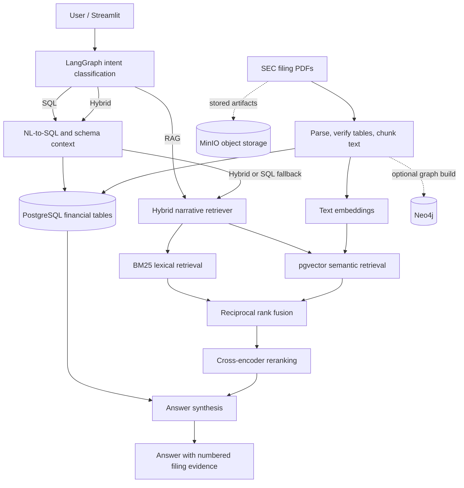

# FundLens

### Agentic financial research across SEC filings

FundLens is a Python financial-document intelligence application that combines **structured financial data (SQL)** with **narrative evidence (RAG)**. A **LangGraph** workflow routes each question to the appropriate path and presents results through a **Streamlit** interface. The current demonstrated dataset covers **Alphabet (GOOGL) FY2024 Form 10-K and Q1 2025 Form 10-Q**.

> **Status:** Research/portfolio prototype. Not a financial adviser, investment recommendation engine, or audited financial-data service. Evaluation results below apply to a small, curated Alphabet benchmark.

## Demo Video

Watch FundLens in action:

[Watch the FundLens Demo](YOUR_YOUTUBE_VIDEO_URL)

The demo covers SQL, RAG, and Hybrid question answering
using Alphabet's SEC financial filings.

## Why FundLens?

Financial questions often need different evidence:

- **SQL** for exact values such as annual revenue and net income.
- **RAG** for narrative disclosures such as AI liability, competition, and regulatory risks.
- **Hybrid** for questions requiring both a financial metric and an explanation grounded in a filing.

Instead of making every question go through the same pipeline, FundLens classifies intent and routes it through task-appropriate components.

## Architecture



The local Docker configuration also includes Redis; its use in the evaluated query path was **not separately validated**. See [architecture details](docs/ARCHITECTURE.md).

## Technology

**Application:** Python, Streamlit, LangGraph, Groq.  
**Storage and search:** PostgreSQL, pgvector, BM25, SentenceTransformers, cross-encoder reranking, MinIO.  
**Ingestion:** PDF parsing (Docling pipeline), financial-table extraction and normalization, section-aware narrative chunking and embeddings.  
**Optional / local infrastructure:** Neo4j, Redis, Docker Compose.

## Measured results

| Benchmark metric | Result |
|---|---:|
| Automated functional checks | **30 / 30 passed** |
| Correct routing decisions | **30 / 30** |
| Exact SQL numerical checks | **21 / 21** |
| Nonempty final answers | **30 / 30** |
| LLM-judged evidence-supported claims | **47 / 47** |
| LLM-judged retrieval Precision@5 | **44% (11 / 25)** |
| LLM-judged numbered citation support | **11 / 11** |
| Median / p95 end-to-end latency | **20.66 s / 47.12 s** |

**Scope matters:** The functional test used 10 curated questions repeated three times. Quality judgments used `openai/gpt-oss-20b` via Groq on five RAG/Hybrid answers from one run. These **are not human-verified factual accuracy figures**. Original-PDF page accuracy is unverified. After rejecting a retrieval experiment and restoring the stable implementation, a five-question core smoke test passed **5/5**. See [full evaluation and limitations](docs/EVALUATION.md).

## Demo questions

| Mode | Example |
|---|---|
| SQL | What was Alphabet's FY2024 revenue? |
| RAG | What AI-related risks did Alphabet discuss in its 2024 annual report? |
| Hybrid | What was Alphabet's FY2024 revenue, and what AI-related risks did its annual report discuss? |

See [demo walkthrough](docs/DEMO.md) for expected evidence, routes, and financial reference values.

## Getting started

**Requirements:** Python 3.10+, Docker with Compose, a Groq API key, and your own downloaded public SEC filing PDF(s). The initial embedding/reranking model downloads require internet access. Ingestion can be slow on CPU.

```cmd
cd /d F:\Github\Fundlens
conda activate docmind_env
python -m pip install -e ".[ingestion,dev]"
copy .env.example .env
docker compose up -d
set "PYTHONPATH=%CD%\src"
python -m streamlit run app.py --server.port 8502
```

Fill in `.env` with **your own** credentials before running the services. These commands match the inspected public-project layout and the Windows environment used during evaluation; adapt them to your actual clone and dependency manager. **A fresh database does not contain the evaluated financial data** until you ingest filings. Docker initialization scripts run only when creating a **new** Postgres data volume—never reset your working volume as a quick fix.

Full instructions, example ingestion commands, and troubleshooting: [docs/SETUP.md](docs/SETUP.md).

## Project navigation

```text
app.py                 # Streamlit UI
src/fundlens/agent/     # LangGraph routing, SQL, RAG, answer synthesis
src/fundlens/ingestion/ # SEC PDF parsing, financial mapping and embeddings
src/fundlens/storage/   # Database, object storage, optional graph helpers
scripts/               # Ingestion, evaluation and maintenance scripts
docker/                # PostgreSQL setup
docs/                  # Architecture, setup, results and demo
```

This is an overview, not a guaranteed exhaustive listing of every local development file.

## Evaluation and limitations

The reported 44% retrieval Precision@5 indicates weakly relevant chunks are sometimes included in the top-five results; it **does not** mean 44% answer accuracy. The attempted focused-query optimization was rejected after poor live regression results; the stable version was restored and passed its core smoke test. Other limitations include the small single-company benchmark, LLM judge variability, intermittent upstream inference latency, and lack of independently verified PDF-page citations.

Read [evaluation details](docs/EVALUATION.md) and the [retrieval experiment record](docs/RETRIEVAL_EXPERIMENT.md).

## Safety and data handling

Generated SQL is intended to be restricted to read-only operations, but this should **not** be treated as a security guarantee without independent deployment validation. For any hosted deployment, use a database account with strictly read-only permissions, add authentication/rate limiting, and protect service credentials. Do **not** publish `.env`, keys, raw ingestion outputs, local database volumes, or private filings. See the [publication checklist](docs/PUBLISH_CHECKLIST.md).

## Primary filing references

- [Alphabet FY2024 Form 10-K](https://s206.q4cdn.com/479360582/files/doc_financials/2024/q4/goog-10-k-2024.pdf)
- [Alphabet Q1 2025 Form 10-Q](https://s206.q4cdn.com/479360582/files/doc_financials/2025/q1/goog-10-q-q1-2025.pdf)

*The PDFs are linked for transparency; no claim of independently audited page-level citation accuracy is made.*
