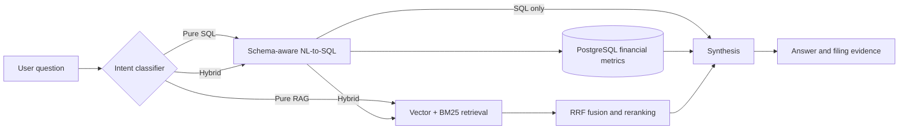
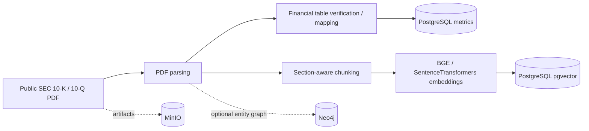

# FundLens architecture

## Query processing

The LangGraph state machine can fall back to retrieval when SQL generation fails. Accordingly, the benchmark checks SQL success and Hybrid combination separately, rather than treating a response that happens to contain the right number as successful SQL execution.

## Ingestion and indexing

### Components and responsibilities

| Component | Role | Notes |
|---|---|---|
| LangGraph | Task routing and orchestration | SQL, RAG, and Hybrid routes |
| SQL agent | Structured financial answers | Depends on mapped financial tables and LLM-generated queries |
| PostgreSQL | Authoritative structured metrics | Quantities in USD millions for the evaluated facts |
| BM25 + pgvector | Lexical and semantic passage retrieval | Combined using reciprocal rank fusion |
| Cross-encoder | Rerank candidate narrative passages | Relevance varies by question |
| Groq | Generation, synthesis, and evaluation judge | External API latency and failures possible |
| Streamlit | Local interactive demonstration | Not a hardened multi-user deployment |
| MinIO | S3-compatible source/artifact storage | Deployment-specific keys and permissions |
| Neo4j | Optional entity/relationship graph path | Not part of measured accuracy claims |
| Redis | Present in inspected local Compose configuration | No independently verified impact on queried benchmark |

### Provenance and limitations

The routing includes filing-year and document-section constraints in the validated stable implementation. In the rejected Hybrid experiment, at least one FY2024 question retrieved a 2025 10-Q chunk; reverting restored correct filing metadata in the five-case core check. Source-card indices were checked automatically, but **page-specific PDF provenance has not been audited against original pages**.

### Responsible usage

Financial figures can be rounded for readability in the UI. Exact-value evaluation is computed using underlying SQL rows, not rounded narrative text. Outputs are for research and demonstration, not personalized investment advice.
